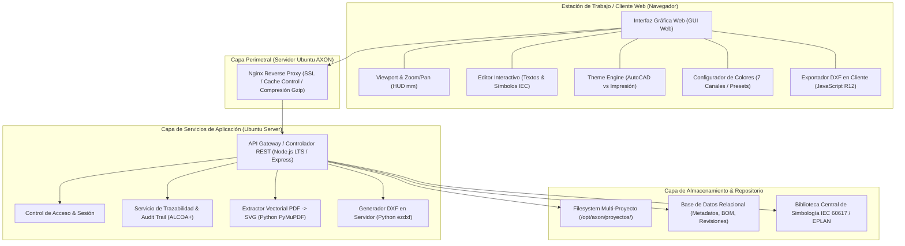
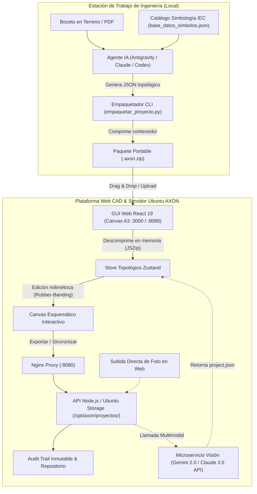

# Arquitectura del Sistema — Diagrama-HTML (AXON CAD Web)

**Documento:** ARQ-01  
**Versión:** 1.0.0  
**Fecha:** 2026-10-21  
**Estado:** Aprobado para Fase 1  
**Norma de Referencia:** GAMP 5 / IEEE 1471 / IEC 60617 / ALCOA+

---

## 1. Visión y Objetivos Arquitectónicos

El proyecto **Diagrama-HTML** evoluciona desde un conjunto de utilidades HTML/SVG estáticas hacia una **Plataforma Web Industrial Distribuida** alojada en el **Servidor Ubuntu de AXON**, proporcionando:

1. **Aislamiento e Integridad (ALCOA+)**: Inmutabilidad de láminas aprobadas, trazabilidad de modificaciones con autor y fecha, y cálculos deterministas.
2. **Compatibilidad CAD Bivalente**:
   - Visualización y edición en **Espacio Modelo** (AutoCAD Electrical fondo oscuro ACI).
   - Visualización, previsualización e impresión en **Espacio Papel** (DIN A3 fondo blanco con inversión automática de textos y líneas).
3. **Cero Dependencia de Licencias Propietarias para Visualización**: Operación completa en navegadores modernos sin necesidad de instalar suites CAD pesadas en estaciones cliente.
4. **Interoperabilidad Nativa con AutoCAD Electrical**: Capacidad de exportar a archivos métricos DXF 1:1 reales (420 x 297 mm) para su apertura e integración directa en proyectos de planta sin desfases de escala.

---

## 2. Diagrama de Arquitectura de Alto Nivel



---

## 3. Descomposición por Capas

### 3.1. Capa Cliente (Frontend SPA / Vanilla Architecture)
Diseñada para máxima velocidad, respuesta instantánea y capacidad offline-first:
- **`ViewportController`**: Gestión de lienzo matricial, zoom geométrico centrado en ratón (10% a 500%), desplazamiento panorámico y proyección HUD en coordenadas métricas reales `(X: 0..420 mm, Y: 0..297 mm)`.
- **`ThemeController`**:
  - `theme-autocad`: Espacio de diseño con fondo `#131822`, líneas ACI (#1a66ff, #38bdf8, #ef4444, #22c55e) y textos de alto contraste.
  - `theme-print`: Papel blanco DIN A3, con reglas CSS forzadas que reescriben elementos ex-blancos a negro `#000000` y fondos oscuros a blanco sin recargar el SVG.
- **`ColorConfigurator`**: Mapeo dinámico de 7 canales mediante CSS Custom Properties (`--print-color-cyan`, `--print-color-text`, `--print-color-muted`, `--print-color-blue`, `--print-color-amber`, `--print-color-green`, `--print-color-red`), persistencia en `localStorage` y sincronización DOM bidireccional.
- **`DxfExporter`**: Serializador vectorial en JavaScript capaz de transformar tags `<line>`, `<rect>`, `<circle>`, `<text>` y `<path>` a formato DXF R12 ASCII, asignando colores ACI (1 al 7) y capas normalizadas.

### 3.2. Capa de Servicios Backend (Ubuntu Server)
Servicios modulares desplegados mediante systemd / PM2 en el Servidor Ubuntu:
- **Gestión de Proyectos Multi-tenant**:
  - Estructuración normalizada por cliente y proyecto:
    `/opt/axon/proyectos/<CLIENTE>/<NUM_PROYECTO> <TITULO>/CAD/`
  - Control de versión con bloqueo de concurrencia y preservación de históricos en `ANTERIORES/` u `OLD/`.
- **Motor de Ingesta Vectorial (`PdfVectorExtractor`)**:
  - Microservicio en Python que recibe un PDF de ingeniería y extrae cada página como SVG vectorial independiente (1191x842 pt), generando miniaturas rasterizadas para navegación inmediata.
- **Audit Trail & Trazabilidad Farmacéutica (GAMP 5 / ALCOA+)**:
  - Cada modificación genera una entrada inmutable con hash SHA-256 del contenido, usuario responsable, fecha/hora UTC y versión documental.

---

## 4. Modelo de Datos y Esquema de Proyectos

### 4.1. Descriptor del Proyecto (`datos_proyecto.js` / `project.json`)
```json
{
  "codigo": "DE-5266",
  "nombre": "SISTEMA CONTROL VISION BLISTERA 3",
  "cliente": "EUROFARMA CHILE SPA",
  "formato": "DIN A3 Horizontal (420 x 297 mm)",
  "norma": "IEC 60617 / EPLAN Style",
  "version_vigente": "Rev. 1.0",
  "total_hojas": 11,
  "hojas": [
    {
      "numero": 1,
      "codigo_lamina": "01",
      "titulo_corto": "Portada",
      "titulo_largo": "Carátula y Portada Principal",
      "disciplina": "General",
      "archivo_svg": "dependencias/hojas/hoja_01.svg",
      "archivo_thumb": "dependencias/hojas/miniaturas/thumb_01.png"
    }
  ]
}
```

---

## 5. Estrategia de Despliegue en Servidor Ubuntu

| Parámetro | Configuración Servidor AXON |
| :--- | :--- |
| **Sistema Operativo** | Ubuntu Server 22.04 LTS / 24.04 LTS x86_64 |
| **Servidor Web / Reverse Proxy** | Nginx (`/etc/nginx/sites-available/diagrama-html`) |
| **Puerto de Exposición Interno** | `http://axon-server.local:8088` o `https://cad.axon.local` |
| **Runtime de API** | Node.js v20+ LTS / Python 3.11+ |
| **Gestor de Procesos** | `pm2` para Node.js / `systemd` para servicios Python |
| **Directorio de Datos** | `/opt/axon/diagrama-html/data/` |

---

## 6. Registro de Decisiones de Arquitectura para Fase 2 (ADRs Aprobados)

Formalización según la metodología Davichuder y estándares GAMP 5 tras la consulta de onboarding de Fase 2:

### ADR-01: Framework Frontend y Bundler
* **Decisión**: Adopción de **React 19 + TypeScript + Vite** con gestión de estado global mediante **Zustand**.
* **Fundamento**: Permite dividir el CAD en componentes limpios y reutilizables, tipado estricto para entidades geométricas (`Point`, `WireNet`, `Port`, `BoundingBox`), y suscripciones atómicas que evitan re-renderizados globales, alcanzando tasas estables de 60 a 120 FPS durante el arrastre y ruteo vectorial.
* **Estado**: Aprobado por el usuario (2026-10-21).

### ADR-02: Ruteo Topológico Ortogonal Adaptativo (Rubber-Banding)
* **Decisión**: Los conductores eléctricos se modelan como entidades topológicas `WireNet` y `WireSegment` con cálculo ortogonal adaptativo en 90° (Manhattan routing con esquinas normalizadas). Al mover un símbolo o borne, los cables conectados recalculan sus codos automáticamente sin romperse ni generar diagonales.
* **Fundamento**: Cumplimiento riguroso de la norma IEC 60617 para esquemas unifilares y multifilares.
* **Estado**: Aprobado por el usuario (2026-10-21).

### ADR-03: Inspector de Propiedades Híbrido (Panel Lateral + Ventana Flotante)
* **Decisión**: Se implementará un panel lateral derecho desplegable integrado (estilo EPLAN / AutoCAD Properties) que puede desacoplarse a petición del usuario como ventana modal flotante no bloqueante.
* **Fundamento**: Brinda máxima ergonomía en pantallas Full HD y 4K sin tapar el área de trabajo de la lámina A3.
* **Estado**: Aprobado por el usuario (2026-10-21).

### ADR-04: Nivel de Criticidad Alta (GAMP 5 Categoría 4 / ALCOA+)
* **Decisión**: El sistema operará bajo lineamientos de **Criticidad Alta / Software Configurado GAMP Cat. 4**. Se implementará un registro inmutable de auditoría (Audit Trail criptográfico con SHA-256), trazabilidad de autor/fecha en cajetines y cobertura de pruebas unitarias (Vitest) y E2E (Playwright).
* **Fundamento**: Requisito mandatorio para emisión de planos en clientes farmacéuticos (Eurofarma, etc.) e industrias reguladas.
* **Estado**: Aprobado por el usuario (2026-10-21).

---

## 7. Arquitectura Híbrida: Digitalización de Bocetos por Agente IA y Paquete Portable (.axon.zip)

### 7.1. Justificación y Principio de Desacoplamiento
La digitalización de bocetos a mano alzada o planos PDF heredados involucra dos etapas con naturalezas computacionales distintas:
1. **Etapa Cognitiva / Interpretativa (Agente IA)**: Lectura visual multimodal, interpretación de caligrafía de campo, deducción de tags (`-KM1`, `-Q1`) y mapeo a símbolos IEC normalizados.
2. **Etapa de Ingeniería / Validación Técnica (GUI Web en Servidor Ubuntu)**: Verificación humana, ajuste fino milimétrico, corte y extensión de conductores, ruteo ortogonal adaptativo, edición de bornas y emisión controlada bajo GAMP 5 / ALCOA+.

La **Opción C: Arquitectura Híbrida** desacopla ambas etapas mediante un contenedor portable estandarizado denominado **`.axon.zip`**, permitiendo que los ingenieros generen proyectos completos con su agente local (Antigravity, Claude Code, Codex) a costo cero y sin latencia, para luego cargarlos al servidor web de AXON con un solo clic.



### 7.2. Especificación del Contenedor Portable (`.axon.zip`)

El archivo `.axon.zip` es un paquete universal autocontenido con la siguiente estructura de archivos:

```text
proyecto_DE-5266.axon.zip
├── project.json            # Modelo topológico íntegro (sheets, wires, components, ports, geometries)
├── metadata.json           # Trazabilidad ALCOA+ (firmas, timestamps, hashes SHA-256 de insumos)
├── bocetos/                # Imágenes JPG/PNG originales de terreno o PDF base
│   ├── boceto_01.png
│   └── boceto_02.png
└── preview/                # Miniaturas y SVGs pre-renderizados para visualización rápida
    ├── hoja_01.svg
    └── thumb_01.png
```

#### Contrato de Datos: `project.json`
```json
{
  "projectCode": "DE-5266",
  "projectName": "CONTROL VISION BLISTERA 3",
  "client": "EUROFARMA CHILE SPA",
  "standard": "IEC_60617",
  "format": "DIN_ISO_5457_A3",
  "sheets": [
    {
      "id": "sheet_01",
      "meta": {
        "sheetNumber": 1,
        "sheetCode": "01",
        "titleShort": "Fuerza",
        "titleLong": "Circuito de Alimentación Principal 380V",
        "discipline": "Fuerza"
      },
      "components": [],
      "wires": [],
      "geometries": []
    }
  ]
}
```

#### Contrato de Trazabilidad: `metadata.json`
```json
{
  "projectCode": "DE-5266",
  "version": "Rev. 1.0",
  "createdAt": "2026-10-21T20:15:00Z",
  "createdBy": "Agente IA Antigravity / E. Pino",
  "gampCategory": 4,
  "bocetos": [
    {
      "file": "bocetos/boceto_01.png",
      "sha256": "e3b0c44298fc1c149afbf4c8996fb92427ae41e4649b934ca495991b7852b855"
    }
  ]
}
```

### 7.3. Registro de Decisión ADR-05
* **Decisión**: Adopción de la **Arquitectura Híbrida (Opción C)** basada en el contenedor portable `.axon.zip`.
* **Fundamento**:
  1. **Cero Dependencia de Red**: Los ingenieros pueden digitalizar cuadernos enteros con su agente local en vuelos, plantas aisladas o faenas sin requerir acceso a internet.
  2. **Gobernanza Industrial**: El servidor web de AXON mantiene el control centralizado de revisiones, auditoría GAMP 5 y exportación oficial de emisiones sin sobrecargar la infraestructura con inferencias de modelos pesados.
  3. **Escalabilidad**: Se mantiene abierta la integración futura de endpoints de visión directa en el servidor para usuarios que no utilicen IDEs de IA.
* **Estado**: Aprobado por el usuario (2026-10-21).
