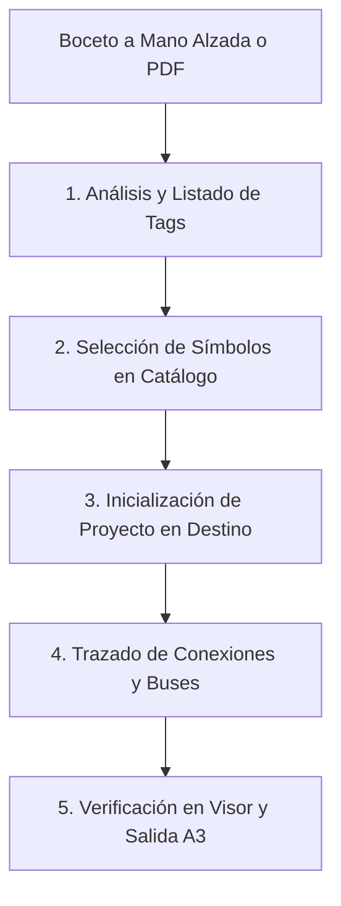

# Guía de Digitalización de Diagramas Eléctricos a Mano Alzada

Este documento define el procedimiento técnico estándar para tomar un **boceto a mano alzada** o un **plano PDF existente** y convertirlo en un proyecto de planos eléctricos industriales en formato **HTML/SVG normalizado para impresión en A3 horizontal**.

---

## 🚨 REGLA FUNDAMENTAL DE UBICACIÓN (SALIDA OBLIGATORIA)

> [!IMPORTANT]
> **NUNCA generar ni almacenar archivos de un encargo dentro de `HERRAMIENTAS/Diagrama-html/`.**
> 1. **Si el origen es un Bosquejo (`BOSQUEJO/`):** La salida del HTML y su carpeta `dependencias/` debe guardarse **en la carpeta raíz contenedora de la carpeta del bosquejo** (ej. si el bosquejo está en `CAD/BOSQUEJO/`, la salida va en `CAD/`).
> 2. **Si el origen es un archivo PDF:** La salida del HTML y su carpeta `dependencias/` debe guardarse **en la misma carpeta donde reside el PDF** (ej. en `1_RECIBIDO/` o `CAD/ELECTRICAL/`).

---

## 1. Flujo de Trabajo en 5 Pasos



---

## Paso 1: Recepción y Análisis del Boceto

1. **Identificar la Disciplina de la Lámina**:
   - **Fuerza**: Alimentación 380V/220V, disyuntores, diferenciales, fuentes, motores, contactores.
   - **Control**: Maniobra 24VDC, botoneras, optoacopladores, relés.
   - **PLC & I/O**: Borneros de entradas/salidas de CPU Siemens, Phoenix Contact o módulos SM/Inline.
   - **Accionamientos**: Variadores de frecuencia (VDF) o servocontroladores (SEW).
   - **Neumática**: Manifolds, electroválvulas 3/2, 5/2, cilindros, FRL.
   - **Borneras**: Regletas de interconexión (X1, X2), cables multipar.
2. **Tabular los componentes del boceto**:
   - Designación normalizada (Tag): `QA1`, `KM1`, `M1`, `PS0`, `OP1`, `V1`, `S0`, etc.
   - Fabricante y modelo previstos (ej. Siemens S7-1200, Phoenix Contact ILC, Mean Well, Schneider).
   - Numeración de bornas o pines (ej. `L, N, PE`, `A1-A2`, `13-14`, `U-V-W`).

---

## Paso 2: Selección de Símbolos en la Biblioteca

1. Abre en tu navegador el catálogo visual interactivo:
   ```
   HERRAMIENTAS/Diagrama-html/catalogo_simbolos.html
   ```
2. Busca los símbolos requeridos (ej. motor, disyuntor, optoacoplador, borna).
3. Haz clic en **"Copiar HTML"** o **"Copiar Ruta"** del símbolo para obtener su código o enlace relativo:
   - Ejemplo: `<image href="simbologia/fuerza/disyuntor_diferencial.svg" x="100" y="200" width="80" height="60" />`
4. **Si el boceto incluye un componente nuevo**:
   - Recórtalo desde un plano CAD anterior usando el script:
     ```powershell
     python herramientas_offline\recortar_simbolo.py [num_pag] [x0] [y0] [x1] [y1] [categoria] [id] [nombre] [descripcion]
     ```

---

## Paso 3: Inicializar el Proyecto en la Carpeta Correcta

Ejecuta el script maestro offline indicando la ruta del insumo:

### Opción A: Desde Bosquejos a Mano Alzada
```powershell
python "HERRAMIENTAS\Diagrama-html\herramientas_offline\iniciar_proyecto.py" "C:\...\CAD\BOSQUEJO" DE-5266 "EUROFARMA" "VISION BLISTERA 3"
```
*El script detecta la carpeta `BOSQUEJO`, calcula automáticamente el directorio raíz `CAD/` y crea allí el visor HTML (`index.html`) y la subcarpeta `dependencias/` con las miniaturas y bocetos vinculados.*

### Opción B: Desde un Archivo PDF
```powershell
python "HERRAMIENTAS\Diagrama-html\herramientas_offline\extraer_hojas_pdf.py" "C:\...\1_RECIBIDO\plano.pdf"
```
*El script extrae automáticamente cada página en SVG vectorial puro y crea el visor interactivo en la misma carpeta donde reside el PDF.*

---

## Paso 4: Trazado de Conexiones y Componentes

En el archivo SVG correspondiente dentro de `dependencias/hojas/hoja_XX.svg`:

1. **Alinear por Columnas (8 a 1)**:
   - Columna 8: `X = 110`
   - Columna 7: `X = 250`
   - Columna 6: `X = 390`
   - Columna 5: `X = 530`
   - Columna 4: `X = 670`
   - Columna 3: `X = 810`
   - Columna 2: `X = 950`
   - Columna 1: `X = 1090`
2. **Insertar los Símbolos**:
   Pega los snippets copiados del catálogo en la coordenada X de la columna correspondiente.
3. **Trazar los Cables (Wires)**:
   - Línea vertical de cable: `<line x1="250" y1="70" x2="250" y2="160" class="wire-control" />`
   - Punto de derivación (nodo): `<circle cx="250" cy="70" r="3" fill="#dc2626" />`
   - Referencia cruzada (flecha): `<polygon points="250,600 240,615 260,615" fill="#0f172a" /><text x="250" y="630" class="wire-text">/12.3</text>`

---

## Paso 5: Verificación en Visor e Impresión Normalizada

1. Abre `index.html` en tu navegador desde la carpeta del proyecto.
2. Comprueba con la tecla `C` la correspondencia directa entre el boceto original y el plano vectorial.
3. Activa el modo mover con la tecla `M` para hacer microajustes de posición en textos y cables.
4. Presiona **Ctrl+P** o el botón **"Imprimir A3"**:
   - Destino: Guardar como PDF / Impresora de planos.
   - Tamaño de papel: **A3**.
   - Orientación: **Horizontal**.
   - Márgenes: **Ninguno (0)**.
   - Gráficos de fondo: **Activado**.
